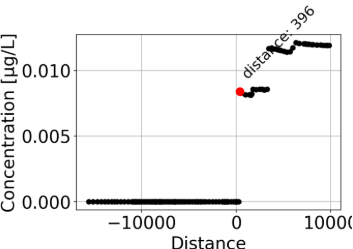
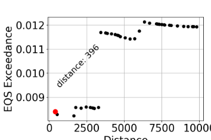
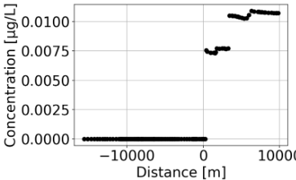

# River Water Quality & CSO Modelling

## Overview

This project investigates the impact of combined sewer overflows (CSOs) on water quality in the Mølle Å river system in Denmark.

The project combines environmental data analysis with a simplified river water-quality model to evaluate pollutant emissions, downstream concentration patterns, and potential exceedance of environmental quality standards.

## Project Objectives

- Analyse water flow and pollutant emissions from CSOs
- Develop a simplified river water-quality model
- Simulate pollutant concentrations along the river
- Evaluate exceedance of environmental quality standards
- Test model behaviour and sensitivity
- Assess the robustness and reliability of model results

## Modelling Approach

The river was represented as a series of completely mixed sections. Pollutant concentrations were simulated along the river by accounting for river flow and pollutant inputs from CSO structures.

The modelling workflow included:

1. Environmental data analysis
2. Model conceptualisation
3. Model diagnosis and testing
4. Local sensitivity analysis
5. Model application
6. Robustness and reliability assessment
   
## Results

### Model Diagnosis

The concentration profile was examined to evaluate whether the model responded realistically to CSO discharges. The model shows a clear increase in pollutant concentration downstream of a major CSO discharge point, followed by dilution along the river.

The corresponding EQS exceedance profile was used to identify river sections where simulated concentrations exceeded the environmental quality standard.

### Model Application

The model was then applied to simulate the spatial distribution of the selected micropollutant along the Mølle Å river. The simulation identified downstream sections with elevated concentrations and potential water-quality risks.

## Key Findings

The modelling results indicated that CSO discharges can cause elevated micropollutant concentrations downstream and lead to exceedance of environmental quality standards in parts of the Mølle Å river system.

The analysis also demonstrated that model outputs are particularly sensitive to selected parameters related to CSO pollutant concentration and discharge characteristics.

## My Contribution

This project was completed as part of a four-person group.

My primary contributions included:

- 60% of the model conceptualisation and development
- Model diagnosis and testing
- 50% of the model application and simulation analysis
- Contribution to report writing, figures, and quality control

## Skills Demonstrated

- Environmental modelling
- Water-quality modelling
- Mass-balance modelling
- Model diagnosis and testing
- Local sensitivity analysis
- Environmental data analysis
- Scientific visualisation
- Team collaboration

## Course

**12104 Environmental Modelling**  
Technical University of Denmark (DTU)

---

*This repository contains a portfolio-oriented summary of the project rather than the original course assignment.*
