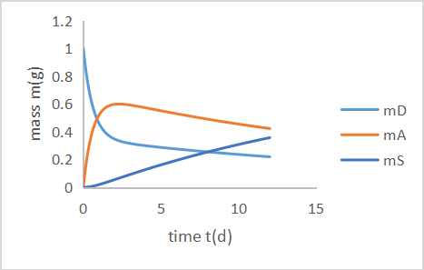
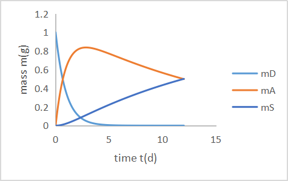
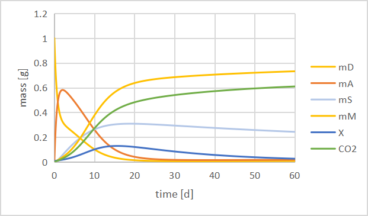

# ODE-Based Contaminant Fate Modelling

## Overview

This project applies ordinary differential equations (ODEs) to model contaminant fate in an environmental system, including adsorption, sequestration, biodegradation, and microbial growth.

Analytical and numerical approaches were used to investigate system behaviour and evaluate the performance of different modelling methods.

## Project Objectives

- Formulate ODEs describing contaminant fate processes
- Derive and evaluate analytical solutions
- Implement numerical solutions using Excel and Python
- Compare analytical and numerical model results
- Investigate contaminant adsorption and biodegradation
- Evaluate model behaviour and sensitivity

## Modelling Approach

The system was represented using coupled differential equations describing key environmental processes.

The modelling workflow included:

1. Formulation of governing equations
2. Analytical solution of simplified cases
3. Numerical implementation
4. Comparison of analytical and numerical solutions
5. Mass-balance evaluation
6. Sensitivity analysis

## Results

### Reversible Adsorption

The reversible system was simulated to examine the transfer of contaminant mass between dissolved (D), adsorbed (A), and sequestered (S) compartments over time.

The simulation shows the redistribution of contaminant mass among the three compartments as the system approaches equilibrium.

### Irreversible Sequestration

The irreversible system was then simulated to investigate contaminant behaviour when sequestration prevents the reverse transfer of contaminant mass.

Compared with the reversible case, the dissolved contaminant mass decreases to nearly zero, while the contaminant is progressively transferred to the adsorbed and sequestered compartments.

### Microbial Biodegradation

The model was extended to include microbial growth and biodegradation, allowing the interactions among dissolved, adsorbed, and sequestered contaminant, microbial biomass, and mineralised carbon to be simulated.

The microbial biomass reached a maximum of approximately 0.129 g at 15.7 days. The simulated specific growth rate decreased over time as the available substrate was depleted.

## Key Findings

The modelling exercise demonstrated how analytical and numerical approaches can be used together to understand contaminant fate and microbial processes.

The comparison of different solution approaches also highlighted the importance of numerical implementation and model assumptions when simulating dynamic environmental systems.

## My Contribution

This project was completed as part of a four-person group.

My primary contributions included:

- Analytical modelling and solution development
- Implementation and analysis using Excel and Python
- Work on Exercise 1 and Exercise 4
- Contribution to model debugging
- Contribution to report writing, figures, and quality control

## Skills Demonstrated

- Ordinary differential equations (ODEs)
- Analytical modelling
- Numerical modelling
- Python
- Excel-based modelling
- Mass-balance analysis
- Sensitivity analysis
- Scientific visualisation
- Model debugging
- Team collaboration

## Course

**12104 Environmental Modelling**  
Technical University of Denmark (DTU)

---

*This repository contains a portfolio-oriented summary of the project rather than the original course assignment.*
