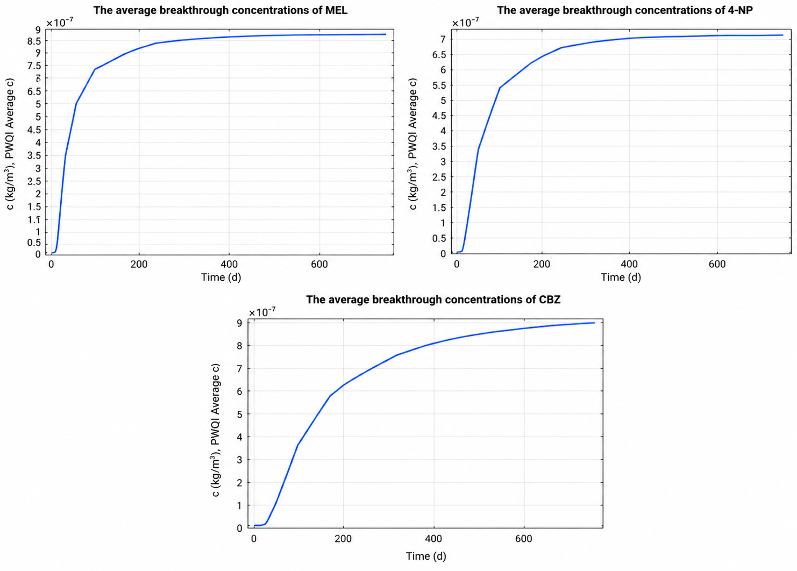
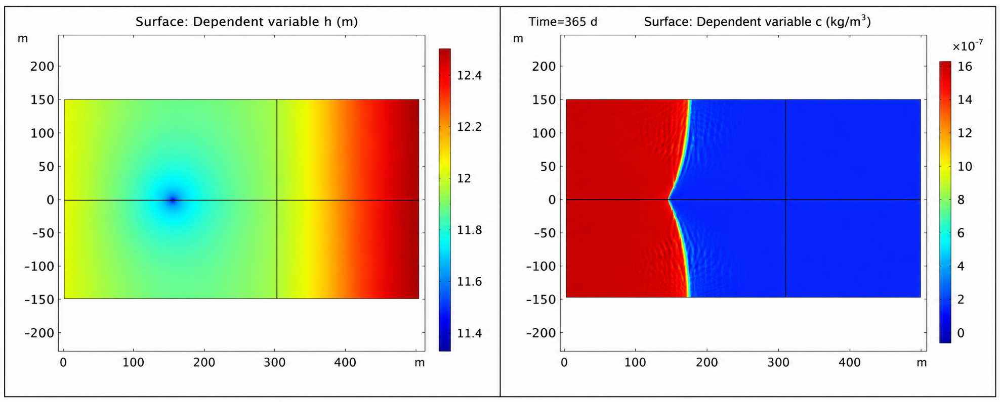
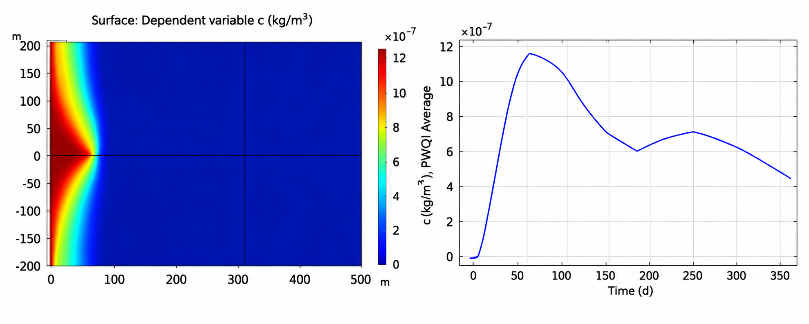

# Riverbank Filtration & Reactive Contaminant Transport

## Overview

This project investigates contaminant transport in a riverbank filtration (RBF) system using a two-dimensional groundwater flow and reactive transport model.

The project focuses on the transport behaviour of persistent and mobile contaminants, including the effects of degradation, retardation, pumping-well location, and time-dependent contaminant input.

## Project Objectives

- Model contaminant transport from a river to a pumping well
- Evaluate the behaviour of persistent and mobile substances
- Calculate first-order degradation rates from contaminant persistence
- Simulate breakthrough curves for selected PMT substances
- Investigate the effect of well distance on contaminant transport
- Simulate time-dependent contaminant input
- Evaluate key model assumptions and uncertainties

## Modelling Approach

A two-dimensional riverbank filtration model was used to simulate groundwater flow and reactive contaminant transport.

The transport analysis considered:

1. Advection and hydrodynamic dispersion
2. Linear sorption and retardation
3. First-order degradation
4. Different contaminant properties
5. Changes in pumping-well location
6. Time-dependent boundary concentrations

## Results

### PMT Breakthrough Behaviour

Breakthrough curves were simulated for three persistent and mobile substances (MEL, 4-NP, and CBZ) to investigate how contaminant-specific transport properties influence concentrations at the pumping well.

Compared with a conservative tracer, the PMT substances showed delayed breakthrough and lower concentrations at the pumping well due to the combined effects of retardation and degradation. Differences among the three substances demonstrate the influence of contaminant-specific transport properties on breakthrough behaviour.

### Effect of Well Distance

The pumping well was moved from 50 m to 150 m from the river to investigate how well location affects groundwater flow and contaminant transport.

Increasing the river-to-well distance weakened the hydraulic coupling between the river and the pumping well and increased groundwater travel time. The contaminant plume consequently advanced more slowly toward the well, resulting in delayed breakthrough.

### Time-Dependent 4-NP Transport

A time-dependent 4-NP concentration was applied at the river boundary to investigate how changing source concentrations affect contaminant transport.

The simulated concentration at the pumping well reached a maximum of approximately 1.19 × 10⁻⁶ kg/m³ on day 84. Unlike the constant-concentration scenario, the time-dependent boundary produced a non-monotonic breakthrough curve: the concentration increased to a peak and subsequently declined as the river concentration decreased.

## Model Limitations

The modelling approach includes several simplifying assumptions that should be considered when interpreting the results:

- **Homogeneous and isotropic aquifer:** Hydraulic conductivity and porosity were assumed to be spatially uniform, whereas natural aquifers are typically heterogeneous.
- **Simplified boundary conditions:** River and external boundaries were represented using idealised boundary conditions, while real river–aquifer interactions may vary over time.
- **Linear sorption and first-order degradation:** Reactive processes were represented using simplified linear and first-order relationships, although real contaminant behaviour may depend on concentration, redox conditions, and microbial activity.

## Key Findings

Reactive transport simulations showed that contaminant properties such as retardation and degradation strongly influence breakthrough behaviour at the pumping well.

Increasing the distance between the river and the pumping well delayed contaminant transport, while time-dependent river concentrations produced non-monotonic breakthrough behaviour that could not be represented by a constant-concentration boundary condition.

## My Contribution

This project was completed as part of a four-person group.

I was primarily responsible for Tasks 15–19, including:

- Calculation of first-order degradation rates for PMT substances
- Simulation and interpretation of PMT breakthrough curves
- Analysis of the effect of pumping-well distance on groundwater flow and reactive transport
- Simulation of time-dependent 4-NP concentrations
- Evaluation of model assumptions and uncertainties
- Contribution to report writing, figures, and quality control

## Skills Demonstrated

- Groundwater contaminant transport modelling
- Riverbank filtration modelling
- Reactive transport
- Advection and dispersion
- Sorption and retardation
- First-order degradation
- Breakthrough-curve analysis
- Scenario analysis
- Model uncertainty assessment
- Scientific visualisation

## Course

**12104 Environmental Modelling**  
Technical University of Denmark (DTU)

---

*This repository contains a portfolio-oriented summary of the project rather than the original course assignment.*
