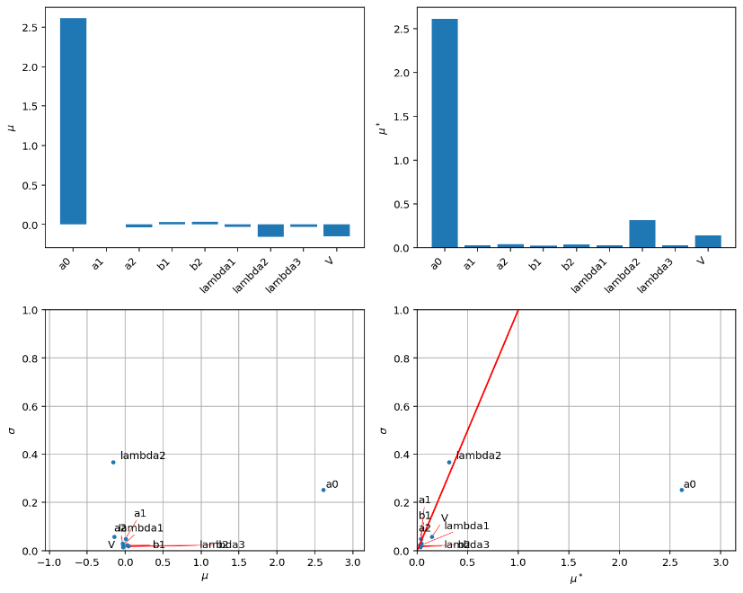
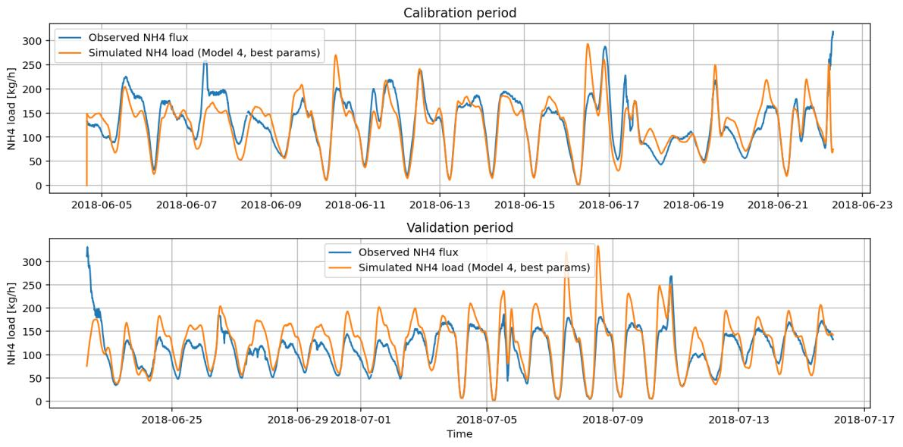

# Wastewater Ammonium Model Calibration

## Overview

This project focuses on modelling ammonium (NH₄⁺) dynamics in sewer systems and wastewater treatment plant inlets.

The modelling workflow combines data analysis, model selection, sensitivity analysis, parameter estimation, calibration, and validation to evaluate how well the model reproduces observed NH₄⁺ behaviour under dry- and wet-weather conditions.

## Project Objectives

- Analyse temporal patterns in wastewater flow and NH₄⁺ dynamics
- Compare alternative model structures
- Identify influential model parameters using sensitivity analysis
- Select an appropriate optimization method for parameter estimation
- Calibrate sensitive model parameters against observed data
- Evaluate calibration performance and parameter bounds
- Assess model performance under different weather conditions

## Modelling Approach

The project followed a structured environmental modelling workflow:

1. Data preprocessing and exploratory analysis
2. Model diagnosis and selection
3. Local sensitivity analysis
4. Global sensitivity analysis using the Morris method
5. Selection of parameters for calibration
6. Global optimization using dual annealing
7. Calibration and validation
8. Evaluation of model performance and limitations

## Results

### Sensitivity-Guided Parameter Selection

Global sensitivity analysis using the Morris method was used to identify the parameters that most strongly influenced model behaviour.

The analysis identified α₀ as the dominant parameter, while λ₂ also showed a meaningful influence on model output. Based on these results, α₀ and λ₂ were selected for subsequent model calibration, allowing the optimization problem to focus on the most influential parameters.

### Model Calibration and Validation

The selected parameters were estimated using the dual-annealing global optimization algorithm. The dataset was divided into calibration and validation periods while maintaining a more balanced distribution of wet-weather events.

The optimized parameter values were:

- **α₀ = 128.216**
- **λ₂ = 6.514**

Both optimized values remained within the parameter ranges defined during the sensitivity analysis.

The calibrated model reproduced the observed NH₄⁺ dynamics reasonably well during the calibration period, capturing the periodic pattern and most peak events. Performance declined during validation, where some simulated peaks were higher and sharper than the observations, indicating reduced generalization under more variable wet-weather conditions.

### Calibration Robustness

The robustness of the calibration was evaluated by repeating the optimization using narrower and wider parameter bounds.

The original parameter ranges produced an inverse MSE of **0.001488**. Narrowing the parameter ranges reduced performance, while widening them produced almost no additional improvement. This indicates that the original sensitivity-analysis-based parameter ranges already captured the optimum effectively.

The calibrated model also reduced the concentration RMSE to approximately **10.9**, demonstrating a substantial improvement in model performance after parameter estimation.

## Key Findings

Sensitivity analysis provided an effective basis for reducing the calibration problem to the most influential parameters. Global optimization substantially improved model fit, while independent validation revealed that model performance was less reliable under variable wet-weather conditions.

This highlights the importance of combining sensitivity analysis, calibration, and validation rather than evaluating environmental models solely on their calibration performance.

## My Contribution

This project was completed as part of a four-person group.

I was primarily responsible for Tasks 3.1, 3.2, and 3.5, including:

- Selection and justification of the optimization method
- Selection of sensitive parameters for calibration
- Model calibration using dual annealing
- Selection of calibration and validation datasets
- Estimation and interpretation of optimized parameter values
- Evaluation of calibration quality and parameter bounds
- Assessment of model performance after calibration
- Contribution to report writing, figures, and quality control

## Skills Demonstrated

- Environmental model calibration
- Parameter estimation
- Global optimization
- Dual annealing
- Sensitivity-analysis interpretation
- Calibration and validation
- Model performance assessment
- RMSE-based evaluation
- Wastewater modelling
- Scientific data analysis
- Scientific visualisation
- Model uncertainty assessment

## Course

**12104 Environmental Modelling**  
Technical University of Denmark (DTU)

---

*This repository contains a portfolio-oriented summary of the project rather than the original course assignment.*
